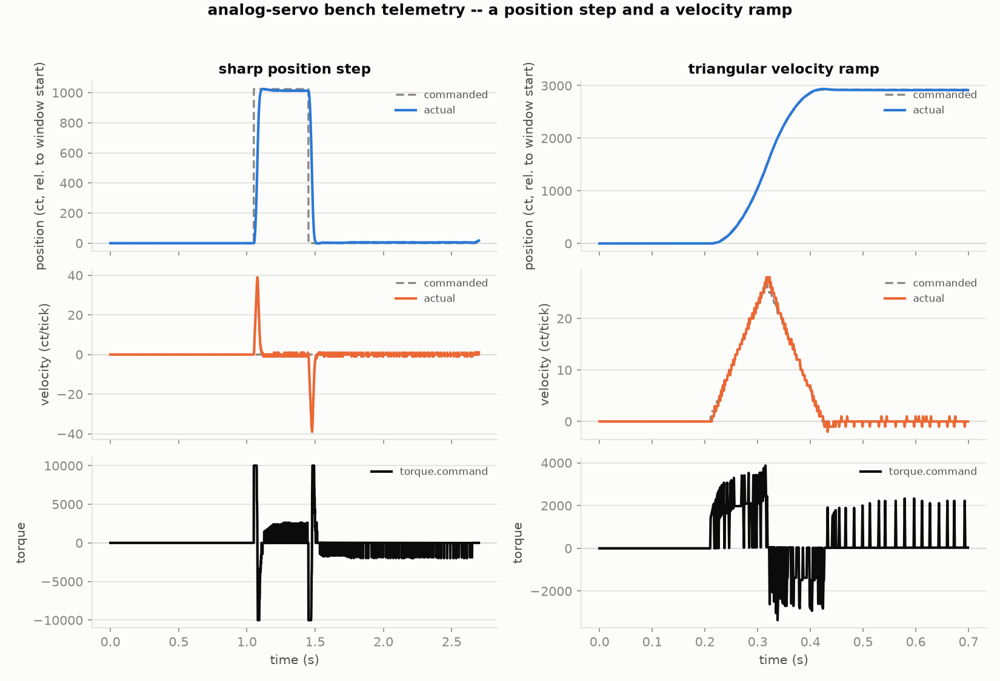

# analog-servo

Closed-loop analog torque-command servo controller firmware. Takes
either step/dir pulses, a high-level velocity command, or an analog
velocity input, runs a cascaded position(P)→velocity(PI) loop, and
drives an external torque amplifier (or a low-voltage motor directly)
via DAC analog output.

This project is aimed at people that want to tinker, learn, and either
keep old servos out of the landfill or try out topologies that might not
be well-supported by existing manufacturers.

**Q: Is this going to produce better results than a Teknic Clearpath?**
A: No, almost certainly not.

**Q: Is it going to be cheaper than a Clearpath?**
A: Only if your time is free.

**Q: Why not use SimpleFOC or something else off-the-shelf?**
A: I had an existing board sitting in my garage for years, uninterested
in fighting toolchain issues, open bugs, and supply voltage limitations.
This project decouples the control from the drive so you hopefully don't
need to learn everything all at once.

**Q: What hardware do I need to try this?**
A: A NUCLEO-L152RE dev board (the only board this repo currently
supports — see `AGENTS.md` for others in progress), a quadrature
encoder, and either a small low-voltage motor driven directly from the
on-chip DAC, or a real servo drive with an analog torque-command input
(see the two worked examples below).

**Q: Is this safe to run unattended, on a motor that can hurt something?**
A: Read `docs/limitations.md` and `docs/primer/why-faults-matter.md`
first — this firmware has no current sensing and no way to read an
external drive's own fault output, so a wiring mistake it fails to catch
can go unnoticed until something gets hot. It is a hobby project, not a
certified safety system.

## Two worked examples

Written up in `docs/examples/` (not yet part of this first published
version — see *Repo map* below):

- `sm232-tq10.md` — the low-inertia case: a Parker SM232A motor through
  an OEM670T drive's TQ10 torque-command card. Bench-validated,
  confirmed tune, 64ms settle / ~1ct overshoot.
- `brushed-dc-magnetic-encoder.md` — the high-inertia case: a treadmill
  motor (large flywheel) with a magnetic encoder added, also through a
  TQ10 card. No bench time on this one yet.

## Repo map

- `firmware/` — the PlatformIO project. Build: `pio run -d firmware`.
  Native unit tests: `pio test -d firmware -e native`.
- `docs/` — design docs, bring-up/tuning guides, and the two examples
  above, as a Sphinx/MyST site. Written, but **not yet tracked in git**
  — held back from this first published version rather than shipped
  half-reviewed; see `AGENTS.md`.
- `tools/` — host-side Python: a live telemetry viewer, tuning search
  tools, a bench-move capture/plot pair, a generic serial console, and a
  sigrok decoder/capture script for the binary telemetry protocol.

See [`AGENTS.md`](AGENTS.md) for the project's conventions (branch
strategy, flash-config versioning, documentation house style) if you're
working on the firmware itself.
