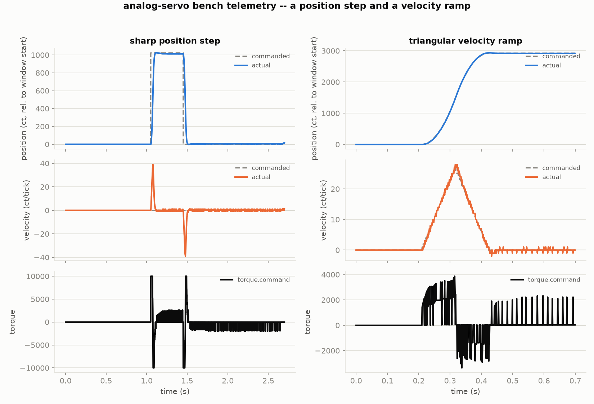
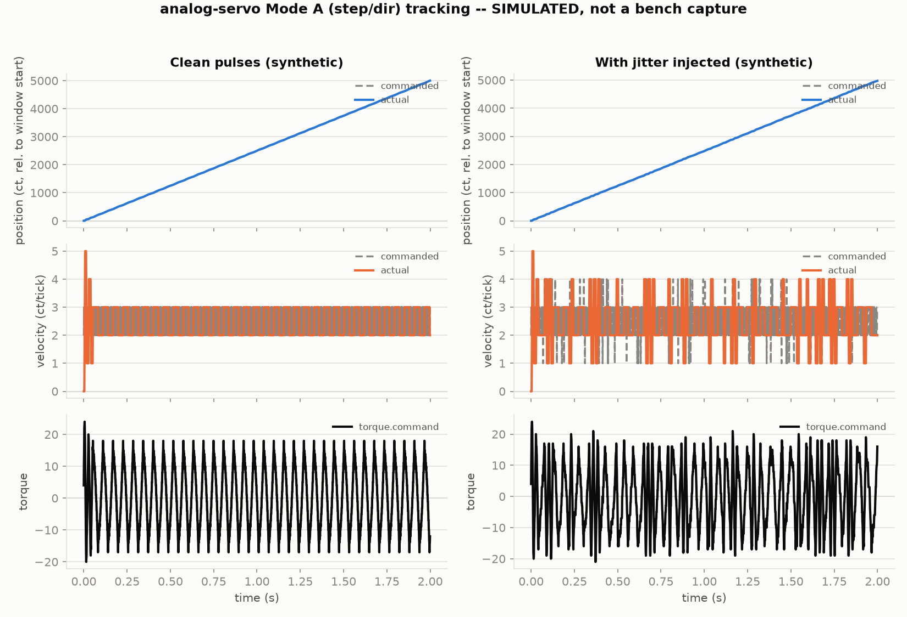
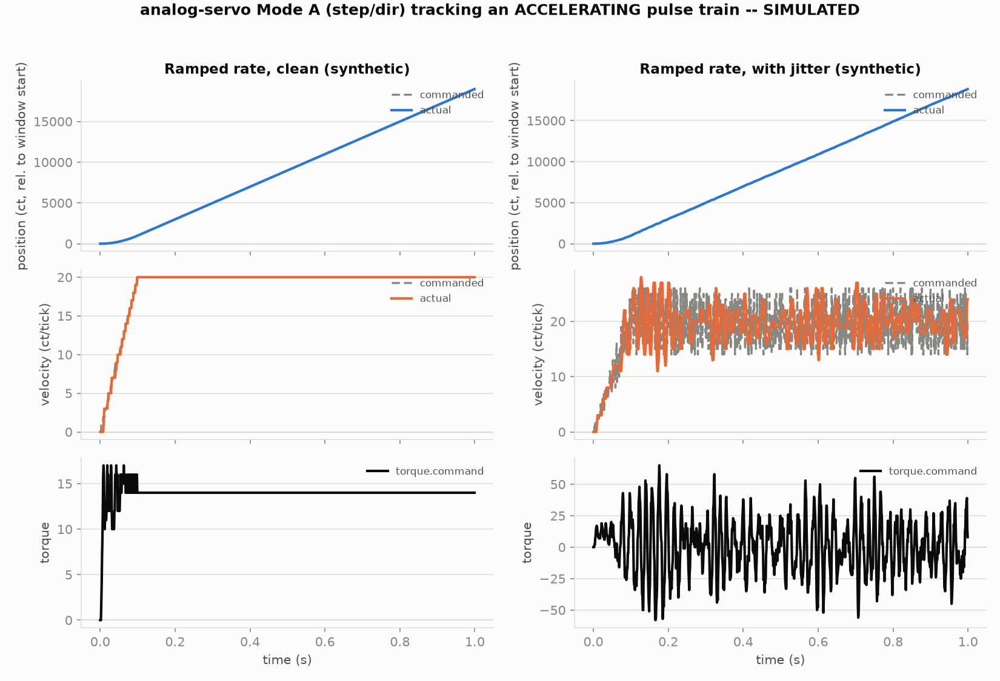
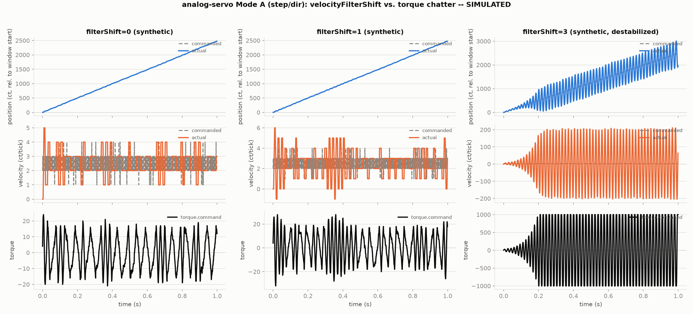
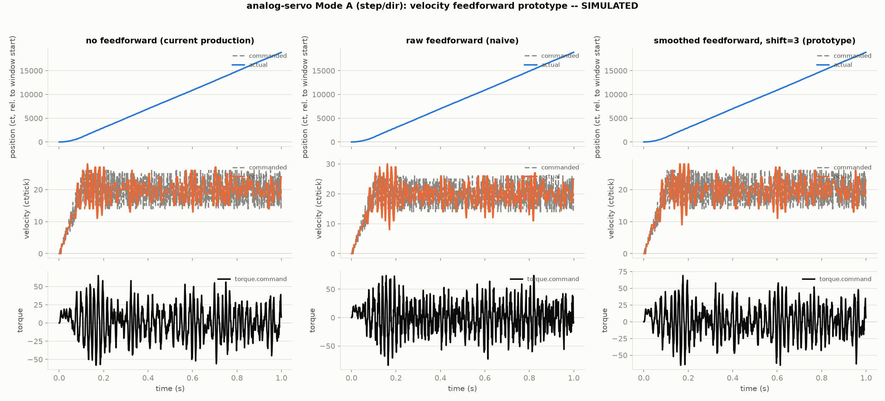

# analog-servo

Closed-loop analog torque-command servo controller firmware. Takes
either step/dir pulses, a high-level velocity command, or an analog
velocity input, runs a cascaded position(P)→velocity(PI) loop, and
drives an external torque amplifier (or a low-voltage motor directly)
via DAC analog output on NUCLEO-L152RE, or RC-filtered PWM on an
STM32F103C8T6 Blue Pill.

This project is aimed at people that want to tinker, learn, and either
keep old servos out of the landfill or try out topologies that might not
be well-supported by existing manufacturers.











These four are all generated, not captured -- see `tools/stepdir_pulse_demo.py`
(regenerate all four in place after a `Control.c` change with
`python3 tools/stepdir_pulse_demo.py`, no arguments needed). The last one is
a prototype, not what Mode A actually does today: it explores feeding
`Control.c`'s existing feedforward path (already used by Mode B/C) from Mode
A too. Shown at the hardest scenario tested, where the win is real but
partial; on a more moderate ramp the smoothed version beats today's
reactive-only tracking on both lag and chatter at once -- see
`firmware/test/test_stepdir_control.c`'s PROTOTYPE section for the numbers.

**Q: Is this going to produce better results than a Teknic Clearpath?**
A: No, almost certainly not.

**Q: Is it going to be cheaper than a Clearpath?**
A: Only if your time is free.

**Q: Why not use SimpleFOC or something else off-the-shelf?**
A: I had an existing board sitting in my garage for years, uninterested
in fighting toolchain issues, open bugs, and supply voltage limitations.
This project decouples the control from the drive so you hopefully don't
need to learn everything all at once.

**Q: What hardware do I need to try this?**
A: A NUCLEO-L152RE or STM32F103C8T6 Blue Pill, a quadrature encoder,
and a torque-command amplifier. The L152 has an on-chip DAC; the F103
needs external RC filters on its PWM outputs. The L152 can also drive a
small low-voltage motor directly from its DAC (see the examples below).

## Build and validation

```sh
pio test -d firmware -e native
pio run -d firmware -e analog_servo       # NUCLEO-L152RE
pio run -d firmware -e analog_servo_f103  # STM32F103C8T6
python -m unittest discover -s tools -p 'test_*.py' -v
```

CI runs native and host-tool tests and builds both boards. These checks
catch logic and build regressions; they do not verify wiring, USB reset
behavior, output filtering, or closed-loop stability on a motor.

F103 boot, composite USB enumeration, warm-reset re-enumeration, and
flash-address correction have been checked on hardware. Later motor
experiments remain separate from this board-support change. Mode A
step/dir and Mode C analog-input operation on F103 are not yet
bench-validated.

The F103 outputs positive/negative torque PWM on PA6/PA7. Hardware enable
is PB12; the UART console uses USART1 on PA9/PA10. Use an external ST-LINK
to flash it. The flash-config page starts at `0x0800FC00` on the documented
64 KiB part. `output.trim` uses signed torque units (full scale ±32767),
not raw DAC/PWM codes. Config version 2 rejects older saved records;
restore your settings and run `config save` after upgrading.

**Q: Is this safe to run unattended, on a motor that can hurt something?**
A: Read `docs/limitations.md` and `docs/primer/why-faults-matter.md`
first — this firmware has no current sensing and no way to read an
external drive's own fault output, so a wiring mistake it fails to catch
can go unnoticed until something gets hot. It is a hobby project, not a
certified safety system.

## Two worked examples

Written up in `docs/examples/` (not yet part of this first published
version — see *Repo map* below):

- `sm232-tq10.md` — the low-inertia case: a Parker SM232A motor through
  an OEM670T drive's TQ10 torque-command card. Bench-validated,
  confirmed tune, 64ms settle / ~1ct overshoot.
- `brushed-dc-magnetic-encoder.md` — the high-inertia case: a treadmill
  motor (large flywheel) with a magnetic encoder added, also through a
  TQ10 card. No bench time on this one yet.

## Repo map

- `firmware/` — the PlatformIO project. Build: `pio run -d firmware`.
  Native unit tests: `pio test -d firmware -e native`.
- `docs/` — design docs, bring-up/tuning guides, and the two examples
  above, as a Sphinx/MyST site. Written, but **not yet tracked in git**
  — held back from this first published version rather than shipped
  half-reviewed; see `AGENTS.md`.
- `tools/` — host-side Python: a live telemetry viewer, tuning search
  tools, a bench-move capture/plot pair, a generic serial console, and a
  sigrok decoder/capture script for the binary telemetry protocol.

See [`AGENTS.md`](AGENTS.md) for the project's conventions (branch
strategy, flash-config versioning, documentation house style) if you're
working on the firmware itself.
